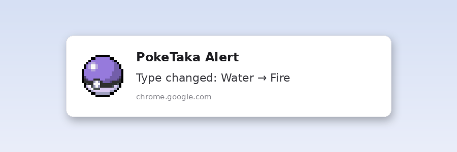
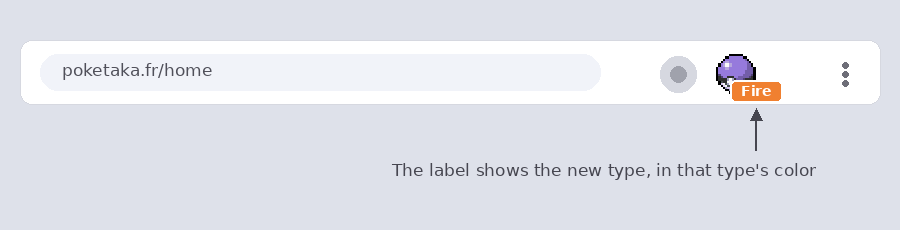
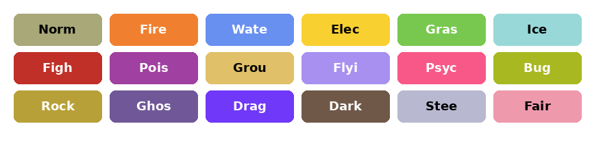

# PokeTaka Alert

A small Chrome extension that tells you when the **Favoured type** changes on [PokeTaka](https://poketaka.fr/home), so you never have to keep checking the page yourself.

Created by **Annabelesca**.

> This is an unofficial, fan-made project. It is not affiliated with PokeTaka, Nintendo, Game Freak or The Pokémon Company.

---

## What it does

PokeTaka shows a *Favoured type* badge on its home page. When that type changes, PokeTaka Alert lets you know right away:

- **A desktop notification** tells you what changed, for example *Water → Fire*.
- **A small label on the extension icon** shows the new type, in that type's color (orange for Fire, blue for Water, green for Grass, and so on).
- **It remembers the last type it saw**, even if you close the page or restart your browser. This way you only get alerted when something has really changed.

When you click the extension icon, the label disappears, which means "alert seen".

## Screenshots

**Desktop notification**

**Colored label on the extension icon**

**Colors used for each type**

## How it works

1. Keep a PokeTaka tab open in Chrome.
2. The extension quietly looks at the Favoured type on the page.
3. The first time, it just remembers the current type and does not alert you.
4. From then on, whenever the type is different from the one it remembers, you get a notification and the colored label.

That's all. There is nothing to configure.

## Installation

PokeTaka Alert is installed manually from the Releases page of this repository. It takes about a minute.

1. **Download the extension.** Go to the [latest release](../../releases/latest) of this repository and download the file `PokeTaka-Alert-v1.0.0.zip` from the **Assets** section at the bottom. (You do not need the files called *Source code*.)
2. **Unzip the file** somewhere you will not delete it later (for example, a folder in your Documents). Chrome needs the folder to stay in place.
3. **Open the extensions page.** In Chrome, type `chrome://extensions` in the address bar and press Enter.
4. **Turn on Developer mode.** Use the switch in the top-right corner.
5. **Load the extension.** Click **Load unpacked** and select the unzipped folder (the one that contains the file `manifest.json`).
6. **Pin the icon** (recommended). Click the puzzle-piece icon in the Chrome toolbar and then the pin next to *PokeTaka Alert*. This way the colored label is always visible.

You are done. Open [poketaka.fr](https://poketaka.fr/home) and leave the tab open.

## Tips

- **Allow notifications.** If you do not see any alerts, check that Chrome is allowed to show notifications in your system settings, and that *Do Not Disturb* or *Focus mode* is not turned on.
- **Keep a PokeTaka tab open.** The extension can only notice changes while the page is open in your browser.
- **Updating.** To install a newer version, download the new ZIP from the [Releases page](../../releases), replace the files in your old folder with the new ones, and press the reload button on the extension's card in `chrome://extensions`.

## Privacy

PokeTaka Alert only runs on poketaka.fr. It does not collect, send or share any data. The only thing it stores, on your own computer, is the last type it saw.

## Browser support

Made for Google Chrome. Other Chromium-based browsers (such as Edge or Brave) may work too, but they have not been tested.

## Something not working?

If the extension stops detecting changes, the website may have changed its layout. Please open an issue in this repository and describe what you see.
